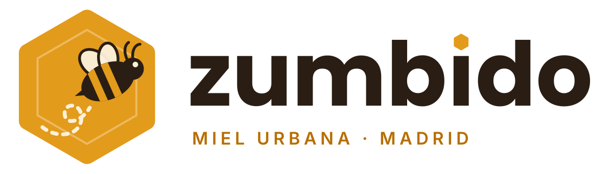

# SGE · UD7 — Odoo de principio a fin

Tarea UD7 de **Sistemas de Gestión Empresarial** (2.º DAM, MEDAC): instalación de Odoo, usuarios, grupos y privilegios, y un proceso de venta completo del presupuesto a la factura.

| | |
|---|---|
| **Alumno** | Sergio Mitchell Bocero |
| **Empresa** | Zumbido Miel Urbana, S.L. (empresa ficticia de apicultura urbana en Madrid) |
| **ERP** | Odoo 19.0 Community, instalador oficial de Windows |
| **Acceso** | `http://localhost:8069` · base de datos `zumbido`, sin datos de demostración |
| **Apps** | Ventas, Facturación, Inventario y Contactos |
| **Vídeo** | *(pendiente)* |

## Índice

1. **Empresa** — [ficha de la empresa y catálogo](empresa/ficha-empresa.md) · [logo](empresa/logo.png)
2. **Instalación** — [diapositivas del proceso (PDF)](instalacion/instalacion-odoo.pdf) · [errores encontrados](instalacion/errores-instalacion.md)
3. **Usuarios, grupos y permisos** — [usuarios-grupos-permisos.md](usuarios/)
4. **Proceso de venta** — [proceso-venta.md](venta/) · presupuesto y factura en PDF
5. **Capturas** — [capturas/](capturas/)

## Resumen

- **Instalación:** Odoo 19 Community con el instalador de Windows, que trae Python, PostgreSQL 16 y wkhtmltopdf y deja Odoo como servicio en el puerto 8069. Los avisos que salieron (Odoo arrancando antes que PostgreSQL y apps que se instalan solas) están explicados en el documento de errores.
- **Empresa:** Zumbido vende miel cruda de sus colmenas en azoteas de Madrid, velas de cera, material para apicultores y talleres. Tiene logo, colores y documentos propios, 7 productos con imagen (5 almacenables con stock) y 2 clientes, una empresa y una particular.
