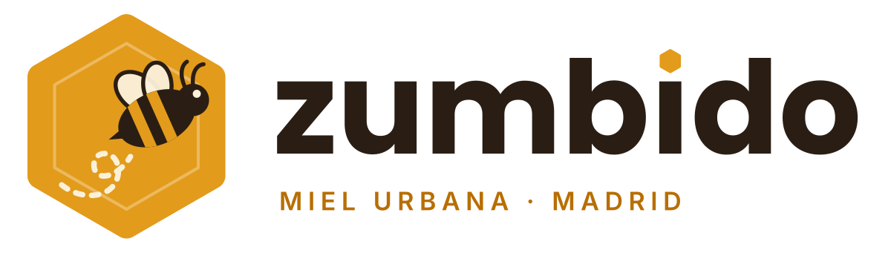
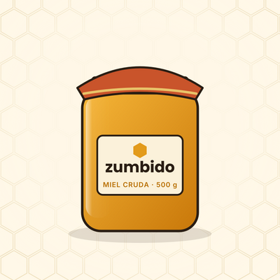
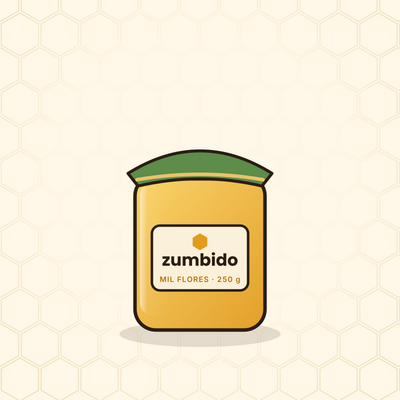
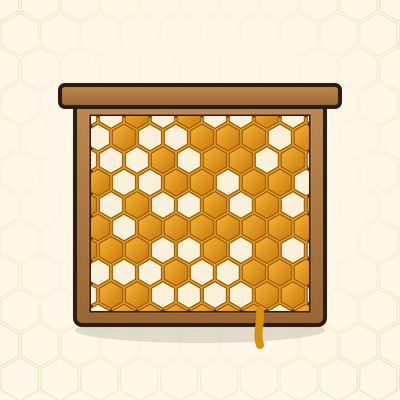
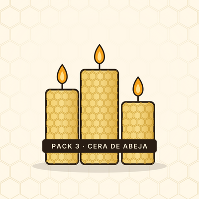
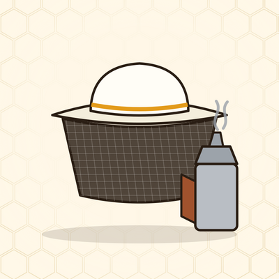
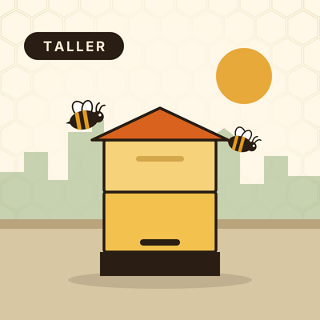
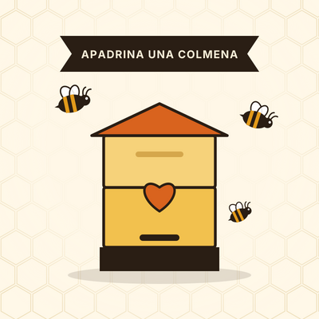

# Ficha de la empresa

| Dato | Valor |
|---|---|
| Nombre comercial | **Zumbido** |
| Razón social | Zumbido Miel Urbana, S.L. |
| NIF | B87391264 |
| Sector | Alimentación artesanal · apicultura urbana |
| Dirección | Calle de la Abeja Obrera, 14 · Nave 2 (azotea) · 28045 Madrid |
| Teléfono | +34 910 555 017 |
| Correo | hola@zumbido-miel.es |
| Web | www.zumbido-miel.es |
| Colores corporativos | Miel `#E39B1B` · Cacao `#2A1E14` · Cera `#FBF1DA` |
| Lema | *Miel cruda de las azoteas de Madrid* |

> Todos los datos son inventados: el NIF tiene un formato válido pero no corresponde a ninguna empresa, y los clientes usan correos `@example.com`, un dominio reservado para ejemplos.

## Actividad

Zumbido cuida colmenas en las azoteas de edificios de Madrid. Vende la miel cruda que producen sus abejas, productos de cera, material para quien quiere empezar con su propia colmena y dos servicios: talleres de apicultura y el plan «Apadrina una colmena» para empresas.

Vende a dos tipos de cliente:

- **Empresas**: restaurantes y tiendas gourmet que compran miel por cajas y contratan talleres para su equipo.
- **Particulares**: compras sueltas y plazas en los talleres.

## Catálogo en Odoo

| | Ref. | Producto | Categoría | Tipo | Precio venta | Coste | IVA | Stock inicial |
|---|---|---|---|---|---:|---:|---|---:|
|  | ZUM-MC500 | Miel cruda de azotea · tarro 500 g | Miel | Bienes, almacenable | 9,90 € | 3,80 € | 10 % | 120 |
|  | ZUM-MF250 | Miel de mil flores · tarro 250 g | Miel | Bienes, almacenable | 5,90 € | 2,10 € | 10 % | 150 |
|  | ZUM-PAN400 | Panal en bastidor · 400 g | Miel | Bienes, almacenable | 14,50 € | 6,00 € | 10 % | 40 |
|  | ZUM-VEL3 | Velas de cera de abeja · pack 3 | Cera y velas | Bienes, almacenable | 12,00 € | 4,20 € | 21 % | 60 |
|  | ZUM-KIT | Kit apicultor urbano | Equipamiento | Bienes, almacenable | 89,00 € | 41,00 € | 21 % | 15 |
|  | ZUM-TALLER | Taller de apicultura urbana (por persona) | Servicios | Servicio | 45,00 € | 12,00 € | 21 % | — |
|  | ZUM-APAD | Apadrina una colmena · plan anual empresa | Servicios | Servicio | 390,00 € | 150,00 € | 21 % | — |

- La miel y el panal llevan **IVA del 10 %** por ser alimentos; el resto, el 21 %.
- Los productos físicos se facturan **según lo entregado** (la factura sale después de validar la entrega); los servicios, según lo pedido.
- Las imágenes de los productos y el logo son ilustraciones propias hechas para esta empresa.

## Clientes

| Cliente | Tipo | NIF | Dirección | Contacto |
|---|---|---|---|---|
| Bistró Azotea 21, S.L. | Empresa | B88512371 | Calle de las Azoteas, 21 · 28012 Madrid | Nerea Alonso Vidal, responsable de compras (usuaria portal) |
| Laura Sánchez Ortega | Particular | — | Calle del Girasol, 7, 3.º B · 28005 Madrid | laura.sanchez@example.com |

## Diseño de documentos

Configurado en *Ajustes → Compañías → Configurar diseño de documento*:

- Plantilla **Bold**, tipo de letra Montserrat.
- Color principal miel `#E39B1B` y secundario cacao `#2A1E14`.
- Cabecera con el logo y los datos de la empresa.
- Pie con razón social, NIF, dirección, teléfono, correo y web, y el lema de la empresa.
- Términos por defecto en presupuestos y facturas (agradecimiento y consejo para la miel cristalizada).
