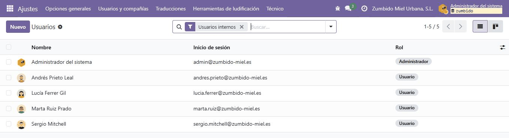
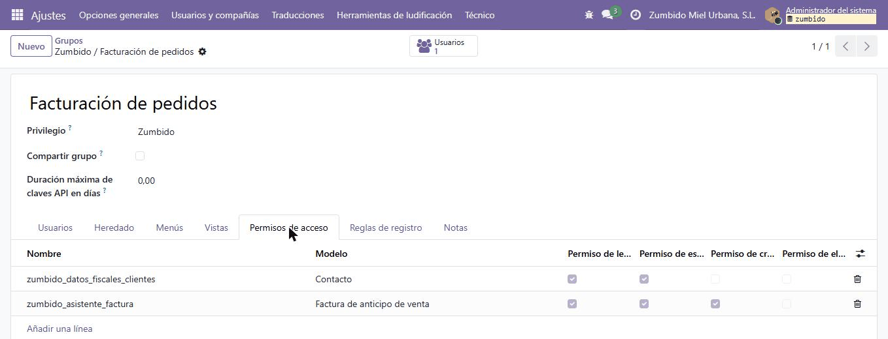

# Usuarios, grupos y privilegios

Plantilla de Zumbido en Odoo 19 aplicando el **principio de mínimo privilegio**: cada persona solo tiene los permisos que necesita su puesto. Las contraseñas no aparecen aquí; solo el correo con el que inicia sesión cada usuario.

## Tipos de usuario en Odoo

| Tipo | Qué es | En Zumbido |
|---|---|---|
| **Interno** | Empleado con acceso al backend de Odoo (las apps). Sus permisos salen de los grupos que tiene. | Los cuatro empleados y el administrador. |
| **Portal** | Persona externa (cliente o proveedor) que entra en su portal `/my` y solo ve sus propios documentos: presupuestos, pedidos y facturas. | Nerea Alonso, compradora de Bistró Azotea 21. |
| **Público** | Visitante anónimo sin cuenta (por ejemplo, de una web o tienda online hecha con Odoo). | Ninguno: no hemos instalado Sitio web. |

En Odoo 19 el tipo se ve en el campo **Rol** de la ficha del usuario (*Usuario* o *Administrador* son usuarios internos). El usuario portal se crea desde el contacto con *⚙ → Otorgar acceso al portal*, y Odoo lo marca en su ficha como **Usuario externo**.

## Plantilla de usuarios

| Usuario | Correo de acceso | Puesto | Tipo | Grupos / privilegios por módulo | Justificación |
|---|---|---|---|---|---|
| Lucía Ferrer Gil | lucia.ferrer@zumbido-miel.es | Comercial | Interno | **Ventas:** Usuario: solo mostrar documentos propios · resto de apps sin acceso | Prepara presupuestos para sus clientes. No ve los de otros comerciales, ni Facturación, ni Inventario, y no puede crear ni borrar clientes. |
| Sergio Mitchell | sergio.mitchell@zumbido-miel.es | Responsable de ventas | Interno | **Ventas:** Administrador | Ve y confirma todos los presupuestos, da de alta clientes, ve los informes y configura Ventas. No entra en Facturación ni en Inventario y no puede publicar facturas. |
| Marta Ruiz Prado | marta.ruiz@zumbido-miel.es | Administración y facturación | Interno | **Contabilidad:** Facturación + grupo propio **Zumbido / Facturación de pedidos** | Crea la factura desde el pedido, la publica y registra el pago. No puede crear presupuestos ni pedidos. |
| Andrés Prieto Leal | andres.prieto@zumbido-miel.es | Almacén y logística | Interno | **Inventario:** Usuario | Valida las entregas y controla el stock. No ve el menú de Ventas ni el de Facturación. |
| Administrador del sistema | admin@zumbido-miel.es | Responsable de sistemas (yo) | Interno | **Rol:** Administrador | Instala apps y gestiona usuarios y permisos. No se usa para vender ni facturar. |
| Nerea Alonso Vidal | nerea.alonso@example.com | Compras en Bistró Azotea 21 (cliente) | Portal | **Rol:** Portal | Consulta en su portal los presupuestos, pedidos y facturas de su empresa. |

Cada usuario tiene su avatar (ilustraciones hechas para la empresa, no fotos reales). En Odoo 19 los permisos de cada app se eligen en la pestaña **Permisos de acceso** del usuario: el **Rol** (Usuario o Administrador) y, para cada app, su **privilegio** (por ejemplo, *Ventas → Usuario: solo mostrar documentos propios*).

Capturas de la configuración: [Lucía, Ventas](../capturas/usuarios-2-lucia-ventas.png) · [Lucía, sin Contabilidad ni Inventario](../capturas/usuarios-3-lucia-sin-contabilidad.png) · [Marta, Facturación y grupo propio](../capturas/usuarios-4-marta-facturacion.png) · [Nerea, usuario externo (portal)](../capturas/usuarios-5-nerea-portal.png)

## Grupo propio: Zumbido / Facturación de pedidos

Lo creé con el **modo desarrollador** activado, en *Ajustes → Usuarios y compañías → Grupos*.

**Por qué hace falta:** con el privilegio *Contabilidad → Facturación*, Marta puede publicar facturas y registrar pagos, pero no puede abrir el asistente **Crear factura** de un pedido (Odoo le da un error de acceso sobre *Factura de anticipo de venta*) ni ve el menú *Ventas → A facturar*. Darle *Ventas → Usuario* sería demasiado, porque podría crear y confirmar presupuestos. El grupo propio le da justo lo que le falta.

| Campo | Valor |
|---|---|
| Nombre | Facturación de pedidos |
| Privilegio | Zumbido (por eso su nombre completo es *Zumbido / Facturación de pedidos*) |
| Heredado → Grupos implicados | Contabilidad / Facturación |
| Menús | Ventas / A facturar |
| Usuarios | Marta Ruiz Prado |

### Derechos de acceso sobre modelos

| Nombre | Modelo | L | E | C | B |
|---|---|:-:|:-:|:-:|:-:|
| zumbido_asistente_factura | Factura de anticipo de venta (`sale.advance.payment.inv`) | ✅ | ✅ | ✅ | ❌ |
| zumbido_datos_fiscales_clientes | Contacto (`res.partner`) | ✅ | ✅ | ❌ | ❌ |

L = lectura, E = escritura, C = creación, B = eliminación.

- El asistente necesita lectura, escritura y creación porque Odoo crea un registro temporal cada vez que se pulsa *Crear factura*. No hace falta borrar.
- Contactos con lectura y escritura deja a Marta corregir el NIF o la dirección de facturación de un cliente, pero no crear clientes nuevos ni borrarlos.

Resto de pestañas del grupo: [Usuarios](../capturas/grupo-1-usuarios.png) · [Heredado](../capturas/grupo-2-heredado.png) · [Menús](../capturas/grupo-3-menus.png)

## Comprobación de permisos

Inicié sesión con cada usuario, cerrando la sesión entre uno y otro, y guardé capturas de lo que ve y de lo que no:

| Usuario | Puede | No puede | Capturas |
|---|---|---|---|
| Lucía (comercial) | Entrar en Ventas, crear sus presupuestos e imprimirlos. Consultar los contactos. | Ver el presupuesto S00001 de Sergio aunque quite el filtro *Mis presupuestos*. Entrar en Facturación o Inventario (no salen en su menú). Crear clientes (no tiene el botón *Nuevo*) ni borrarlos (en *⚙ Acciones* no sale *Eliminar*). | [menú](../capturas/permisos-lucia-1-menu.png) · [presupuestos](../capturas/permisos-lucia-2-presupuestos.png) · [contactos](../capturas/permisos-lucia-3-contactos.png) · [acciones](../capturas/permisos-lucia-4-sin-eliminar.png) |
| Sergio (responsable) | Ver todos los presupuestos y pedidos, también los de Lucía, y confirmarlos. Ver *Informes* y *Configuración* de Ventas. | Entrar en Facturación o Inventario. Publicar facturas. | [menú y presupuestos](../capturas/permisos-sergio-menu.png) · [pedido de Lucía](../capturas/venta-6-pedido-facturado.png) |
| Marta (administración) | Entrar en Facturación. En Ventas, ver *A facturar*, crear la factura desde el pedido, publicarla y registrar el pago. | Crear presupuestos o pedidos. Ver el resto de menús de Ventas. | [menú](../capturas/permisos-marta-menu.png) · [pedidos a facturar](../capturas/venta-4-pedidos-a-facturar.png) |
| Andrés (almacén) | Entrar en Inventario, validar entregas y ver el stock. | Ver Ventas o Facturación (no salen en su menú). | [menú](../capturas/permisos-andres-menu.png) |

En el [proceso de venta](../venta/proceso-venta.md) cada paso lo hace el usuario de su rol, así que también sirve de prueba de que los permisos dejan trabajar a cada uno en su parte.
