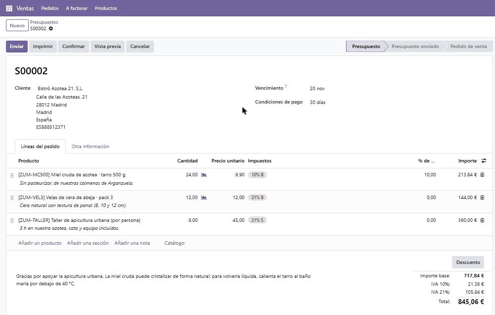
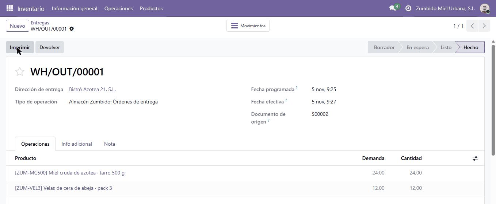
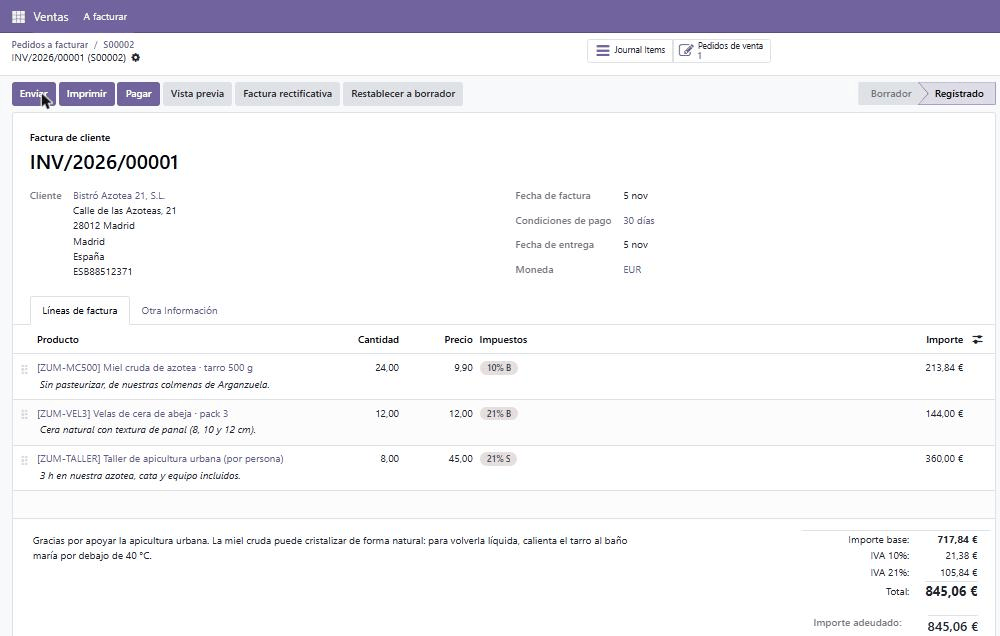
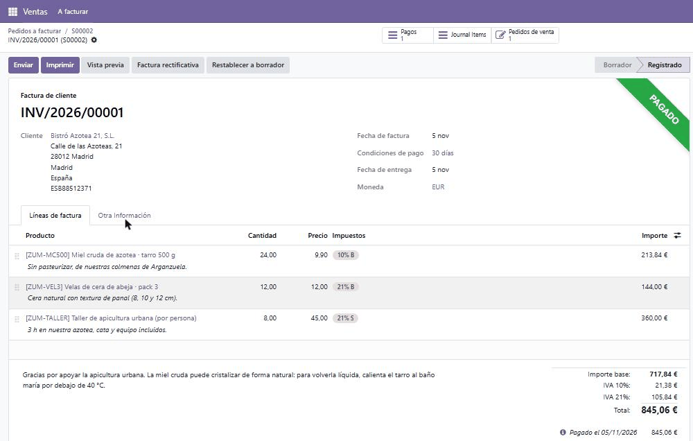

# Proceso de venta: del presupuesto a la factura

Venta completa a **Bistró Azotea 21, S.L.** (cliente empresa) el 05/11/2026. Cada paso lo hizo el usuario de su rol, entrando con su propia cuenta y no con el administrador. El historial (*chatter*) de cada documento guarda quién hizo cada cosa y a qué hora.

| Paso | Usuario | Documento | Estado |
|---|---|---|---|
| 1. Presupuesto | Lucía Ferrer (comercial) | **S00002** | Presupuesto · impreso en [presupuesto.pdf](presupuesto.pdf) |
| 2. Confirmación | Sergio Mitchell (responsable de ventas) | **S00002** | Pedido de venta |
| 3. Entrega | Andrés Prieto (almacén) | **WH/OUT/00001** | Hecho |
| 4. Factura | Marta Ruiz (administración) | **INV/2026/00001** | Registrado · impresa en [factura.pdf](factura.pdf) |
| 5. Pago | Marta Ruiz (administración) | **PBNK1/2026/00001** | Pagado |
| 6. Estado final | Sergio Mitchell (responsable de ventas) | **S00002** | Completamente facturado |

> **S00001** es un presupuesto de prueba para Laura Sánchez con Sergio como comercial, y sigue en borrador. Lo usé para comprobar que Lucía no ve los presupuestos de otros comerciales; no forma parte de esta venta.

## 1. Presupuesto · Lucía

*Ventas → Presupuestos → Nuevo*

| Campo | Valor |
|---|---|
| Cliente | Bistró Azotea 21, S.L. |
| Vencimiento (validez) | 20/11/2026, 15 días |
| Condiciones de pago | 30 días |
| Comercial | Lucía Ferrer Gil |

| Producto | Cantidad | Precio | Desc. | IVA | Importe |
|---|---:|---:|---:|---|---:|
| [ZUM-MC500] Miel cruda de azotea · tarro 500 g | 24 | 9,90 € | **10 %** | 10 % | 213,84 € |
| [ZUM-VEL3] Velas de cera de abeja · pack 3 | 12 | 12,00 € | — | 21 % | 144,00 € |
| [ZUM-TALLER] Taller de apicultura urbana (por persona) | 8 | 45,00 € | — | 21 % | 360,00 € |

| Totales | Importe |
|---|---:|
| Importe base | 717,84 € |
| IVA 10 % (sobre 213,84 €) | 21,38 € |
| IVA 21 % (sobre 504,00 €) | 105,84 € |
| **Total** | **845,06 €** |

Lo guardó y lo imprimió con el botón **Imprimir**: [presupuesto.pdf](presupuesto.pdf).

## 2. Confirmación · Sergio

Sergio abre S00002 (lo ve aunque sea de Lucía, porque es administrador de Ventas), revisa precios y descuento y pulsa **Confirmar**. El presupuesto pasa a **Pedido de venta** y Odoo crea sola la orden de entrega WH/OUT/00001 para el almacén.

- Sergio no ve el botón *Entrega* del pedido porque no tiene permisos de Inventario.
- En Odoo el comercial también puede confirmar sus presupuestos. En Zumbido lo hace el responsable de ventas, para revisar el descuento antes de comprometer el stock.

Capturas: [pedido de venta](../capturas/venta-2-pedido.png) · [historial: creado por Lucía y confirmado por Sergio](../capturas/venta-2-historial.png)

## 3. Entrega · Andrés

*Inventario → Operaciones → Entregas → WH/OUT/00001*

La entrega tiene las dos líneas de producto físico. La cantidad hecha es igual a la pedida (24 y 12) y Andrés pulsa **Validar**: queda en **Hecho** el 05/11/2026 a las 9:27. El taller es un servicio, así que no pasa por el almacén.

| Producto | Stock antes | Entregado | Stock después |
|---|---:|---:|---:|
| Miel cruda de azotea · tarro 500 g | 120 | 24 | **96** |
| Velas de cera de abeja · pack 3 | 60 | 12 | **48** |

Capturas: [stock real después de la entrega](../capturas/venta-3-stock.png) · [historial de movimientos de la miel](../capturas/venta-3-movimientos.png)

## 4. Factura · Marta

*Ventas → A facturar → Pedidos a facturar → S00002 → Crear factura → Factura normal → Crear borrador*

Marta revisa el borrador (cliente, líneas, IVA y condiciones de pago) y pulsa **Confirmar**. Odoo le da el número **INV/2026/00001**, con fecha 05/11/2026 y vencimiento 05/12/2026 por las condiciones de 30 días. La imprimió con **Imprimir**: [factura.pdf](factura.pdf).

La miel y las velas se facturan **según lo entregado**, así que no se podían facturar antes de que Andrés validara la entrega. El taller se factura según lo pedido.

Capturas: [pedidos a facturar](../capturas/venta-4-pedidos-a-facturar.png)

## 5. Pago · Marta

En la factura, **Pagar** → diario *Banco*, 845,06 €, fecha 05/11/2026 → **Crear pago**. Se crea el pago **PBNK1/2026/00001** y la factura queda **Pagado**.

Capturas: [asistente de pago](../capturas/venta-5-pago.png)

## 6. Estado final · Sergio

En *Ventas → Pedidos → Pedidos*, S00002 aparece como **Completamente facturado**. En *Informes → Ventas* (tabla dinámica por producto) salen 44 unidades pedidas, 36 entregadas (el taller no se entrega), 44 facturadas, 717,84 € de base facturada y 845,06 € en total.

Capturas: [pedido completamente facturado](../capturas/venta-6-pedido-facturado.png) · [análisis de ventas](../capturas/venta-6-analisis.png)
